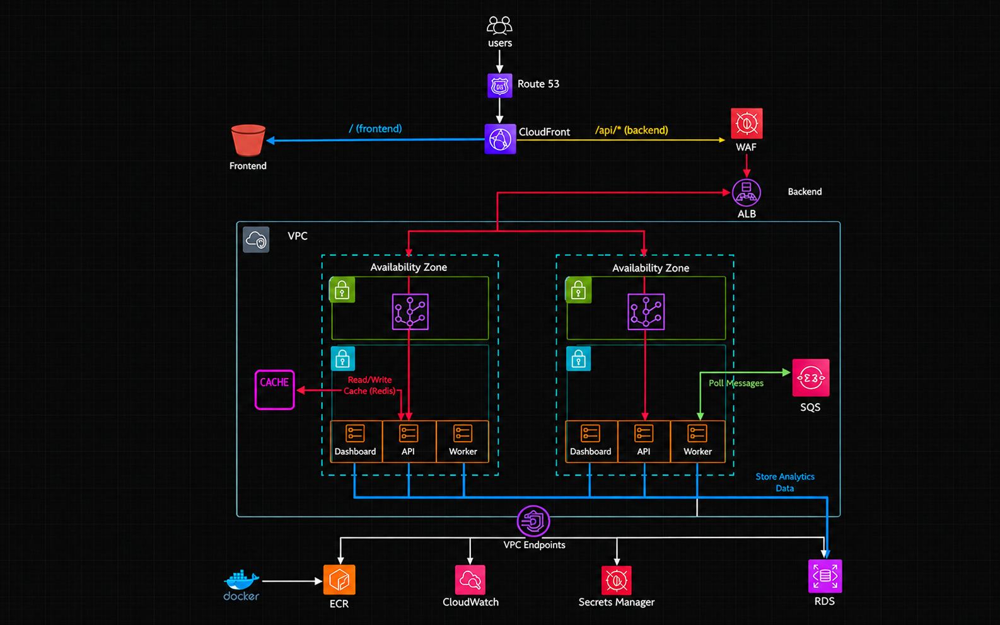
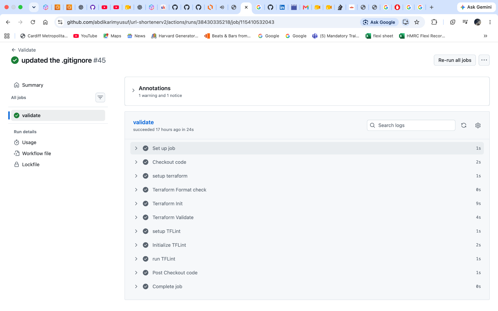
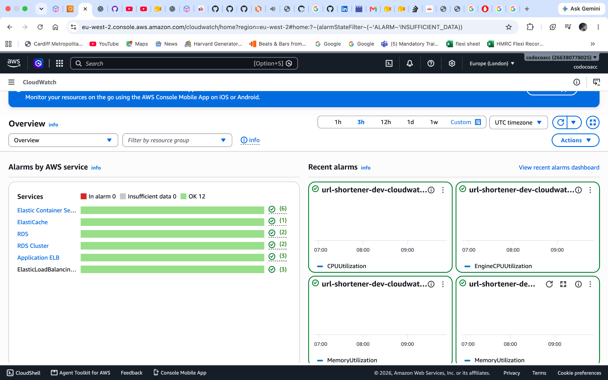
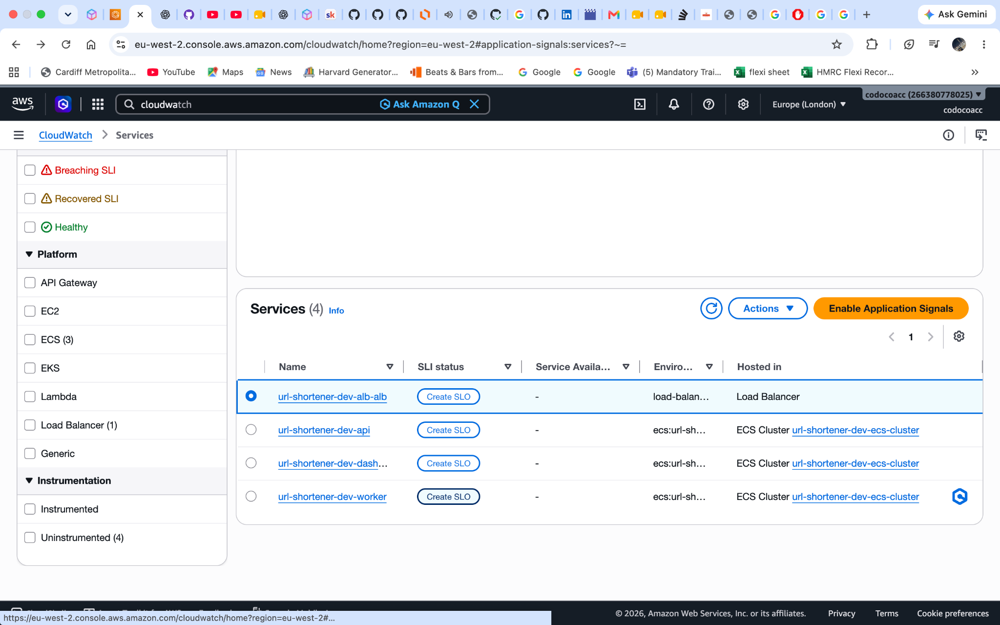
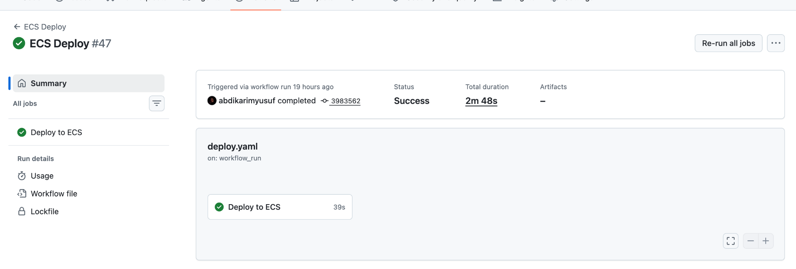
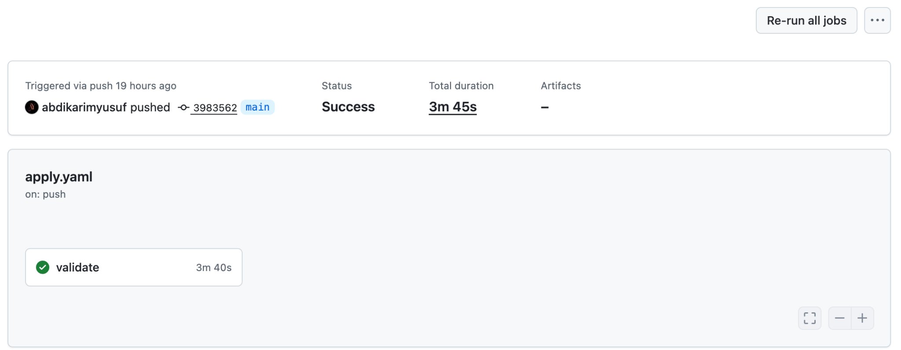
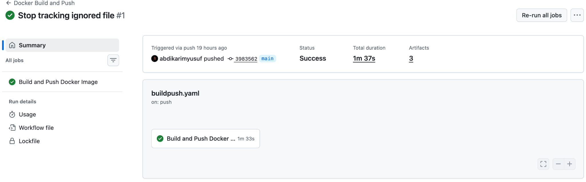
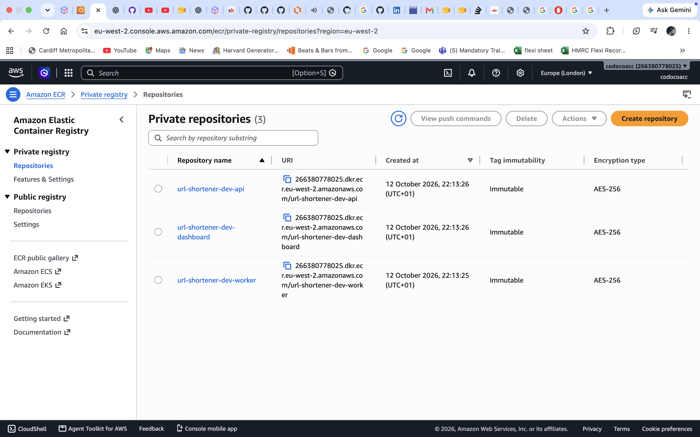
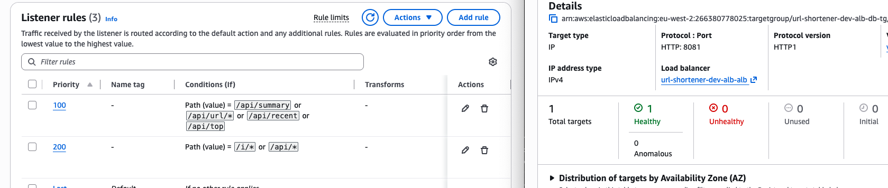
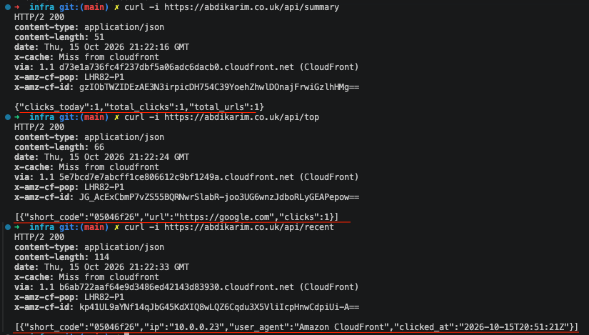

# URL Shortener & Click Analytics on AWS
A multi-service URL shortener built to demonstrate Terraform, AWS networking, container delivery, asynchronous processing, security and cost-aware platform engineering.

**Stack:** AWS · Terraform · ECS Fargate · ECR · RDS PostgreSQL · Redis · SQS · S3 · CloudFront · GitHub Actions · OIDC

---
https://github.com/user-attachments/assets/f9a31066-4451-4b43-a7b9-a9485993ff95

---
## 1. Overview
Users can create short URLs, follow redirects and view click analytics. The application is split into three containerised services:

- **API (FastAPI):** Creates and resolves short URLs, updates click counts and publishes click events.

- **Worker:** Consumes SQS events and writes detailed analytics and hourly aggregates to PostgreSQL.

- **Dashboard:** Exposes analytics endpoints.

The frontend is hosted on S3 and delivered through CloudFront. Redis supports URL-mapping operations, PostgreSQL stores application and analytics data, and CloudWatch provides logs.

\<!-- TODO: Add an end-to-end application screenshot at docs/images/09-application-e2e.png after testing shorten, redirect and analytics. -->

---
## 2. Architecture


Confirm that CloudFront origins, behaviours, WAF attachment and ALB routing in this diagram match the actual deployment.

### Request and event flow
1. The browser loads static assets from CloudFront/S3.

2. The frontend calls the API through the configured route.

3. The API creates a short URL or resolves a mapping, using Redis for mapping operations.

4. On a redirect, the API updates the URL click count and publishes a detailed event to SQS.

5. The worker processes events and writes analytics to PostgreSQL.

6. The dashboard exposes summary, recent activity and top-URL data.

**Consistency note:** The API increments the URL click count directly, while the worker processes detailed analytics asynchronously. Retries or partial failures can cause these views to differ; idempotency and reconciliation are worthwhile improvements.

---
## 3. Key decisions and trade-offs
| Decision | Why it fits | Trade-off / next step |
|---|---|---|
| **ECS Fargate, not Kubernetes** | Runs separate services without managing worker nodes or a Kubernetes control plane. | Can cost more than well-utilised EC2 at steady scale. Right-size tasks and compare costs if usage grows. |
| **RDS PostgreSQL** | Relational data, SQL queries and analytics aggregations. | Ongoing instance/storage cost and connection limits. Tune indexes, retention and connection pooling based on measurements. |
| **Redis** | Can reduce latency for frequently accessed URL mappings. | Adds cost and cache invalidation/failure modes. Define TTL and cache-miss behaviour; measure hit rate. |
| **SQS** | Decouples click processing from user requests and buffers temporary backlog. | Eventual consistency and duplicate delivery. Add a DLQ, sensible visibility timeout, idempotent writes and queue-age alarms. |
| **No NAT gateway** | Reduces fixed cost for a low-traffic portfolio environment. | Private tasks still need access to AWS dependencies. Compare the required VPC endpoints with NAT costs; endpoints are not general internet access. |
| **Terraform modules** | Separates networking, services and data resources for easier review and reuse. | Abstractions add inputs/outputs and can hide behaviour if over-designed. Keep modules focused and test important changes. |
| **GitHub OIDC** | Uses short-lived AWS credentials instead of long-lived access keys. | Security still depends on a restricted trust policy and least-privilege IAM. |
### Terraform-managed vs pipeline-managed ECS deployments
This project currently passes the image tag into Terraform and applies the updated ECS configuration.

- **Terraform-managed (current):** One declared configuration and reviewable plan; deployment shares state/locking with infrastructure changes and can be slower.

- **Pipeline-managed alternative:** Terraform owns baseline infrastructure while the release pipeline registers a task-definition revision and updates ECS. This can speed up application releases, but ownership must be explicit to avoid Terraform drift.

For this project, Terraform-managed releases keep the lifecycle simple. If releases become frequent, move image rollout into a dedicated ECS deployment stage while keeping Terraform as the owner of baseline infrastructure. Do not let both systems independently manage the same fields.

### Commit-SHA tags vs `latest`
Images are tagged with the source commit SHA, allowing a deployment to use the revision built by CI rather than whatever `latest` points to.

- **SHA tag:** Better traceability and repeatable redeployment; enable ECR tag immutability if tags must be write-once.

- **`latest`:** Convenient for experiments, but mutable and ambiguous during incidents or rollback.

- **Image digest:** Stronger content identity than a tag; consider passing the digest through the pipeline for deployment.

A SHA tag alone does not guarantee immutable image content. Pin base images/dependencies where practical, scan images and retain known-good versions.

---
## 4. Terraform and remote state
Terraform manages networking, ECS, ECR, RDS, Redis/SQS integrations, routing and related security resources. Check the current configuration before claiming every service in the list is deployed.

### Bootstrap: solving the remote-state dependency
Terraform cannot initialise a remote backend that does not exist yet. If Terraform itself must create the S3 bucket used as its backend, that creates a bootstrap dependency.

1. Use a small bootstrap configuration with local state (or an already-existing backend) to create the remote-state bucket and prerequisites.

2. Configure the main `infra/` backend to use that bucket and key, then run `terraform init`.

3. If migrating existing local state, back it up and use `terraform init -migrate-state` only after verifying the destination.

4. Protect the bootstrap state as well as the main state.

The main backend uses S3 with lock-file support. Keep state out of Git, restrict access, enable suitable encryption/versioning and never publish state or secret values.

```bash

cd infra

terraform fmt -check -recursive

terraform init

terraform validate

terraform plan

```


---

## 5. CI/CD

Four GitHub Actions workflows separate validation, infrastructure provisioning, image publishing and deployment.

| Workflow | Responsibility |
|---|---|
| `validate.yaml` | Terraform formatting, validation and TFLint. A good next step is YAML linting and Terraform security scanning. |
| `apply.yaml` | Provisions shared infrastructure. `deploy_app_services=false` allows infrastructure/ECR to exist before the first app images. Use reviewed plans and protected approvals for sensitive changes. |
| `dockerpush.yaml` | Builds API, dashboard and worker images and pushes commit-SHA tags to ECR. Add build caching, vulnerability scanning, provenance and an ECR lifecycle policy. |
| `ecs-deploy.yaml` | Runs after a successful image build and uses that build's commit SHA to update ECS through Terraform. Add post-deployment health checks, smoke tests and a tested recovery procedure. |
**Pipeline safeguards:** OIDC with a restricted trust policy, least-privilege IAM, S3 state locking, protected branches, and no deployment after a failed build. Infrastructure apply and ECS deployment must not run concurrently against the same state. GitHub concurrency helps prevent overlap but is not a guaranteed FIFO queue; ensure older runs cannot overwrite a newer release.

---

## Project Screenshots and Demonstration

### 1. AWS Architecture Diagram


### 2. Terraform Validation



### 3. CloudWatch Alarms



### 4. ECS Services Monitoring



### 5. ECS Deployment



### 6. Terraform Apply and Validation



### 7. Docker Build and Push



### 8. Amazon ECR Repositories



---

## 6. Security and operations

- **Identity:** GitHub OIDC; narrow the role trust policy to the intended repository/branch or protected environment.

- **Network:** Restrict security-group rules to required service-to-service traffic. Keep the database private and expose services only through intended routing.

- **Secrets and data:** Use managed secret storage where configured, encrypt persistent data, restrict state access and redact sensitive logs.

- **Containers:** Use minimal/multi-stage images, pin dependencies where practical, scan for vulnerabilities and run with minimal privileges.

- **Observability:** Use CloudWatch logs and add actionable alarms for ECS health, API errors/latency, database connections and SQS backlog/oldest-message age.




### Troubleshooting lessons

These are useful portfolio incident examples; include real logs and mark a fix as resolved only after verification.

| Symptom | Root-cause investigation and lesson |
|---|---|
| ECS task fails health checks soon after starting | The grace period or interval/threshold may be too short for application startup. Compare startup logs with health-check timing, use the correct path/port and tune based on observed readiness. |
| PostgreSQL connection fails with `ssl=disable` / `sslmode=disable` | Inspect the driver's actual error and TLS policy. Configure the required SSL mode and certificate validation rather than disabling TLS as a shortcut. |
| CloudFront API path returns 403/404 | A behaviour such as `/api/*` does not automatically rewrite a path if the FastAPI route is `/shorten`. Align the behaviour/origin path and application route, then test the exact URL end to end. |
| SQS queue not found or worker idle | Verify queue name, region, endpoint and IAM permissions; inspect worker polling logs. |
| ALB returns errors | Check listener rules, target group health checks, container ports and security-group rules. |
For each incident, document **symptom → evidence → root cause → fix → prevention**.

\<!-- TODO: Add real health-check incident evidence and a verified retest at docs/images/10-health-check-incident.png. --> &#x20;

\<!-- TODO: Add CloudFront behaviour and successful API request evidence at docs/images/11-cloudfront-api-routing.png. -->

---

## 7. Cost optimisation

The main cost drivers are usually always-on compute and networking, rather than the URL-shortening requests themselves. Review the actual AWS bill and region-specific prices before claiming a saving.

| Service | Cost control |
|---|---|
| ECS Fargate | Right-size CPU/memory and avoid idle tasks in non-production. |
| RDS / Redis | Use suitable small capacity for development; stop or destroy non-production resources when safe. Preserve required data/backups. |
| NAT / VPC endpoints | Compare fixed hourly and data-processing charges for the actual required endpoints. |
| ALB / WAF / CloudFront | Avoid unnecessary duplicate resources and review request/data-transfer usage. |
| CloudWatch / ECR / S3 | Set log retention and image lifecycle policies; remove obsolete artefacts safely. |
| SQS | Monitor retries/backlog and batch where appropriate. |
### Why avoid a NAT gateway?

A NAT gateway can have a fixed hourly charge even at very low traffic. Using an illustrative reference rate of **$0.045/hour**, one gateway running for 730 hours is about **$32.85/month before data processing**. An interface endpoint at an illustrative **$0.01/hour** is about **$7.30/month per AZ**, before processing; several endpoints across multiple AZs can cost more than one NAT gateway. S3/DynamoDB gateway endpoints have no endpoint hourly charge when applicable.

These are **illustrative USD rates, not an `eu-west-2` quote**. Verify current prices with the [AWS VPC pricing page](https://aws.amazon.com/vpc/pricing/), [PrivateLink pricing](https://aws.amazon.com/privatelink/pricing/) and the AWS Pricing Calculator. NAT provides general outbound access; VPC endpoints only provide access to supported services. Confirm that tasks can reach ECR, logs, secrets and queues before deciding the network design.

\<!-- TODO: Add cost evidence at docs/images/12-cost-analysis.png and label it clearly as actual spend or estimate. -->

---

## 8. Testing and release verification

Before calling a deployment successful:

- Confirm the expected SHA-tagged images were pushed to ECR.

- Confirm ECS task definitions reference the intended revision and services become healthy.

- Create a short URL and verify the redirect.

- Confirm the event reaches SQS and the worker persists analytics.

- Check dashboard output, logs and error responses.

- Test failure cases such as a failed health check, worker restart and duplicate event.

Do not claim zero-downtime releases or automated rollback until those behaviours have been tested. Keep the previous image available and consider database compatibility before rolling application code back.



---

## 9. Improvements roadmap

1. **Release safety:** Post-deployment smoke tests, image digests, tested rollback and strict deployment ordering.

2. **Reliability:** SQS dead-letter queue, idempotent worker writes, queue alarms, cache TTL and dependency-failure tests.

3. **Security:** Terraform and image scanning, tighter IAM, dependency pinning and build provenance.

4. **Cost/performance:** Budgets, resource right-sizing, load tests, measured cache/database performance and endpoint-cost review.

5. **Platform maturity:** Automated infrastructure/integration tests, recovery documentation and separate environments if the project grows.

---

## 10. Portfolio evidence checklist

- [ ] Architecture diagram matches the deployed resources.

- [ ] Four workflows show successful runs.

- [ ] ECR images and ECS deployment use the same source revision.

- [ ] End-to-end application flow is tested.

- [ ] At least one troubleshooting incident shows evidence, fix and retest.

- [ ] Cost estimates are clearly distinguished from actual billing.

- [ ] Screenshots are saved under `docs/images/` and contain no secrets. Only embed screenshots after adding the matching files to `docs/images/`; TODO comments are hidden in the rendered README.

- [ ] Every feature described as implemented has been verified; planned improvements are labelled as planned.

---

## Conclusion

This project demonstrates infrastructure as code, secure AWS authentication, container delivery, asynchronous processing and cost-aware architecture. Its strongest portfolio evidence is not the number of AWS services used, but the ability to explain the design trade-offs, show how failures were diagnosed and prove that the application works end to end.
